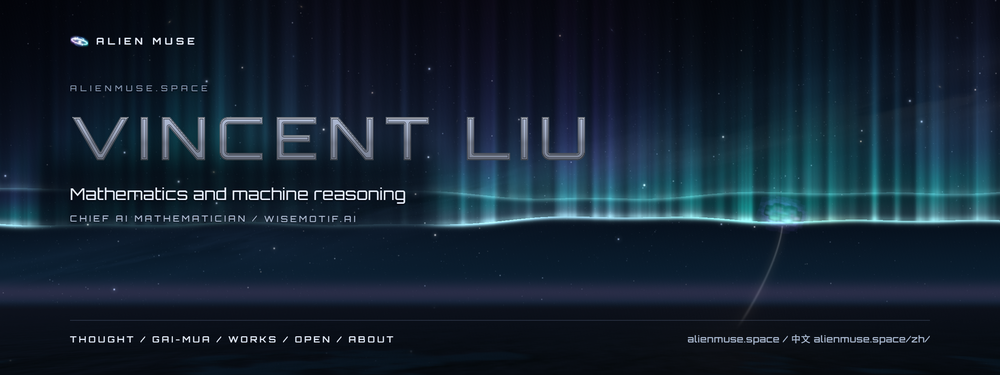

  

   

  <b><a href="https://alienmuse.space/">alienmuse.space</a></b> ·
  <a href="https://alienmuse.space/thought/">Thought</a> ·
  <a href="https://alienmuse.space/gai-mua/">GAI-MUA</a> ·
  <a href="https://alienmuse.space/works/">Works</a> ·
  <a href="https://alienmuse.space/open/">Open</a> ·
  <a href="https://alienmuse.space/about/">About</a> ·
  <a href="https://alienmuse.space/zh/">中文</a> ·
  <a href="https://grothendiecklab.com/">Grothendieck Lab</a> ·
  <a href="https://grothendieckmath.com/">grothendieckmath.com</a> ·
  <a href="https://wisemotif.ai/">WiseMotif.ai</a>

**alienmuse.space** is the site of Vincent Liu, Chief AI Mathematician at [WiseMotif.ai](https://wisemotif.ai/): mathematics and machine reasoning.
The Grothendieckian Programme in seven works, and a biography of Alexander Grothendieck.

The site is one argument in five pages, each handing over to the next:

- [Thought](https://alienmuse.space/thought/): the rising sea, seven principles, twelve theses
- [GAI-MUA](https://alienmuse.space/gai-mua/): the architecture: core, kernel, authority, recursion
- [Works](https://alienmuse.space/works/): the published works, by collection
- [Open](https://alienmuse.space/open/): the 57 problems and what each work leaves open
- [About](https://alienmuse.space/about/): the author, the accounts, the sites

The works, by collection:

- [The Grothendieckian Programme](https://alienmuse.space/works/grothendieckian-programme/) · <https://grothendiecklab.com/>
- [Lives of Mathematical Thought](https://alienmuse.space/works/lives-of-mathematical-thought/) · <https://grothendieckmath.com/>

In English, with a Chinese edition at [alienmuse.space/zh/](https://alienmuse.space/zh/).

## This repository

This repository holds the built site only — static HTML, CSS, a script, fonts and images — published by GitHub Pages at
https://alienmuse.space. The sources of the site, its design system and its tools are not published.

## Licence

The site's code, its design, its scene and its mark: © 2026 Vincent Liu, all rights reserved. The site's own words: CC
BY-NC-ND 4.0. The words quoted from the works keep the licence of each work, as its copyright page states
(CC BY 4.0, CC BY-NC-ND 4.0). See [LICENSE](LICENSE).

The site uses, under their own licences:

- Three.js: [MIT License](static/js/three-LICENSE.txt)
- Orbitron: [SIL Open Font License 1.1](static/fonts/OFL-Orbitron.txt)
- TeX Gyre Pagella and TeX Gyre Pagella Math, as TGP Pagella and TGP Pagella Math: [GUST Font License](static/fonts/GUST-FONT-LICENSE.txt)
- STIX Two Math, as TGP Symbol Math: [SIL Open Font License 1.1](static/fonts/OFL-STIX-Two.txt)
- Simple Icons: [CC0 1.0; each mark belongs to its owner](static/img/SIMPLE-ICONS-LICENSE.md)

© 2026 Vincent Liu · [ORCID 0009-0000-8718-222X](https://orcid.org/0009-0000-8718-222X) · [WiseMotif.ai](https://wisemotif.ai/)
